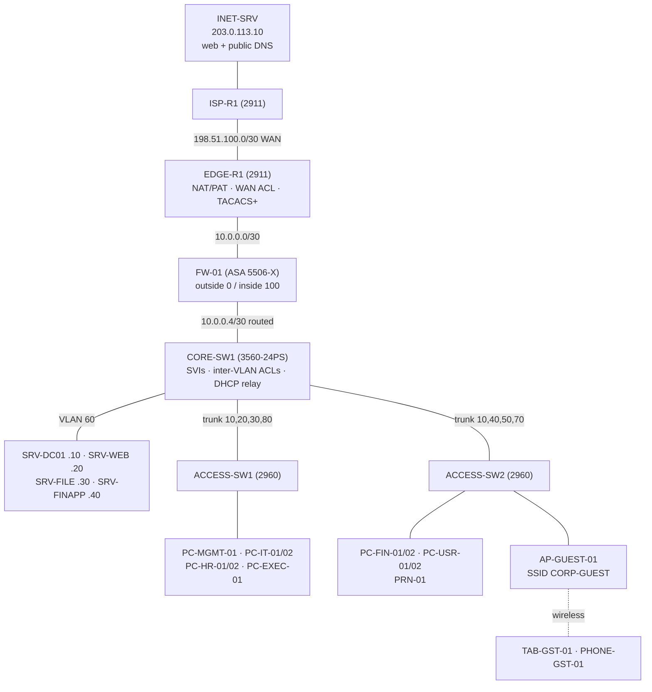

# CORP Enterprise Network — Cisco Packet Tracer Project

A complete small-enterprise network for Cisco Packet Tracer 8.2+. It covers VLAN segmentation, Layer 3 inter-VLAN routing, a perimeter ASA firewall, NAT/PAT, ACLs for each department, centralised DHCP/DNS, TACACS+ (AAA) management login, SSH-only management, switch hardening, guest Wi-Fi and a simulated ISP/Internet.

## About the `.pkt` file (please read)

**This repository does not contain a `.pkt` file, and no file here has been renamed to `.pkt`.**

A `.pkt` file is Cisco's proprietary, encrypted project format. Only Packet Tracer can produce a valid one, and Packet Tracer was not available in the environment that produced this project. Instead, the project ships everything needed to **generate the real `.pkt` inside your own Packet Tracer in a few minutes**:

| Path | What it is |
|---|---|
| `build/ptbuilder-build.js` | Build script for the free [PTBuilder](https://github.com/kimmknight/PTBuilder) Packet Tracer extension. It places all 25 devices, creates all 22 cables, sets host IP settings and pushes every Cisco CLI config. |
| `configs/*.txt` | Complete, paste-ready CLI configurations for every Cisco device (the single source of truth). |
| `docs/04-build-guide.md` | Step-by-step build: the automated PTBuilder path, the fully manual path, and the GUI-only steps (server services, Wi-Fi). |
| `docs/07-validation-and-test-plan.md` | Verification commands and a 39-test functional test plan with expected results. |

Once the build finishes, use **File > Save As** in Packet Tracer and you have a genuine `CORP-Enterprise.pkt`.

> Honesty note: the configurations were written for, and checked against, the command sets of the chosen Packet Tracer models. The ACL logic was machine-checked against the test plan's expected flows. They have **not** been executed inside Packet Tracer in this environment. If your Packet Tracer version rejects a line, `docs/04-build-guide.md` §6 lists the known version-dependent commands and what to do about each.

## Topology



Traffic path to the Internet: **Client → access switch → trunk → CORE-SW1 SVI (ACL) → FW-01 (stateful) → EDGE-R1 (PAT to 198.51.100.2) → ISP-R1 → INET-SRV**

## VLANs

| VLAN | Name | Subnet | Gateway (CORE-SW1) | Addressing |
|---|---|---|---|---|
| 10 | MANAGEMENT | 192.168.10.0/24 | 192.168.10.1 | static (admin PC, switch SVIs) |
| 20 | IT | 192.168.20.0/24 | 192.168.20.1 | DHCP .100–.199 |
| 30 | HR | 192.168.30.0/24 | 192.168.30.1 | DHCP .100–.199 |
| 40 | FINANCE | 192.168.40.0/24 | 192.168.40.1 | DHCP .100–.199 |
| 50 | USERS | 192.168.50.0/24 | 192.168.50.1 | DHCP .100–.199, printer static .10 |
| 60 | SERVERS | 192.168.60.0/24 | 192.168.60.1 | static |
| 70 | GUEST | 192.168.70.0/24 | 192.168.70.1 | DHCP .100–.199, Internet only |
| 80 | EXECUTIVE | 192.168.80.0/24 | 192.168.80.1 | DHCP .100–.199 |
| 99 | NATIVE | — (192.168.99.0/24 reserved, unused) | none | trunk native VLAN only |
| 999 | PARKING | — | none | unused, shut-down ports |

## Documentation

1. [Design and decisions](docs/01-design.md): architecture, routing choice (static instead of OSPF, with the reasons), and how the security layers fit together.
2. [IP addressing plan](docs/02-ip-addressing.md): every interface on every device.
3. [Physical topology and cabling](docs/03-physical-cabling.md): every cable, port role and cable type.
4. [Build guide](docs/04-build-guide.md): how to produce the `.pkt`.
5. [Security and ACL policy](docs/05-security-acl-policy.md): rule-by-rule documentation.
6. [Active Directory–style identity simulation](docs/06-identity-ad-simulation.md): what is simulated, what isn't, and how a real AD would plug in.
7. [Validation and test plan](docs/07-validation-and-test-plan.md)

## Lab credentials

| Purpose | Value |
|---|---|
| Local admin user (all Cisco devices) | `netadmin` / `NetAdmin2026` |
| Enable secret (all Cisco devices) | `EnaSecret2026` |
| TACACS+ user (on SRV-DC01 AAA) | `it.admin` / `ItAdmin2026` |
| TACACS+ shared key | `TacKey2026` |
| ISP-R1 user | `ispadmin` / `IspAdmin2026` |
| Guest Wi-Fi (WPA2-PSK, SSID `CORP-GUEST`) | `GuestWiFi2026` |
| File server FTP user | `employee` / `Files2026` |

These are **lab-only** credentials. Replace all of them before reusing any config outside a lab.

## Regenerating the build script

`configs/*.txt` is the source of truth. After editing a config:

```bash
python3 tools/generate_ptbuilder.py   # rewrites build/ptbuilder-build.js
```
